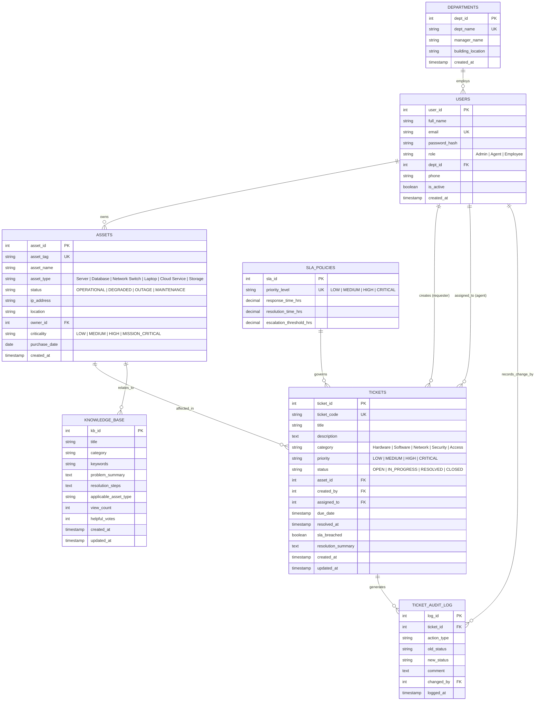

# Entity-Relationship (ER) Diagram & Schema Mapping

## 1. Architectural Overview
The relational component of the **Smart IT Service Desk** models the entities and relationships required for enterprise ITIL service operations:
- **Departments & Users:** Organization structure with hierarchical user roles (Admin, Agent, Employee).
- **SLA Policies:** Contractual turnaround times based on incident severity.
- **Assets (Configuration Items):** Physical and virtual assets linked to owners and incidents.
- **Tickets & Audit Trails:** The central operational entity capturing symptoms, state transitions, assignments, and resolutions.
- **Knowledge Base:** Curated problem-solution pairs linked to asset categories.

---

## 2. Mermaid Entity-Relationship Diagram

---

## 3. Relational Schema Mapping & Integrity Constraints

1. **Primary Keys:**
   - Every table possesses an unambiguous primary key (`dept_id`, `user_id`, `sla_id`, `asset_id`, `ticket_id`, `log_id`, `kb_id`).
2. **Foreign Keys & Referential Actions:**
   - `users.dept_id` $\rightarrow$ `departments.dept_id` (`ON DELETE RESTRICT ON UPDATE CASCADE`)
   - `assets.owner_id` $\rightarrow$ `users.user_id` (`ON DELETE SET NULL ON UPDATE CASCADE`)
   - `tickets.created_by` $\rightarrow$ `users.user_id` (`ON DELETE RESTRICT ON UPDATE CASCADE`)
   - `tickets.assigned_to` $\rightarrow$ `users.user_id` (`ON DELETE SET NULL ON UPDATE CASCADE`)
   - `tickets.asset_id` $\rightarrow$ `assets.asset_id` (`ON DELETE SET NULL ON UPDATE CASCADE`)
   - `ticket_audit_log.ticket_id` $\rightarrow$ `tickets.ticket_id` (`ON DELETE CASCADE ON UPDATE CASCADE`)
3. **Domain & Check Constraints:**
   - `chk_sla_positive_times`: `response_time_hrs > 0 AND resolution_time_hrs >= response_time_hrs`
   - Role Domain: `'Admin'`, `'Agent'`, `'Employee'`
   - Ticket Priority: `'LOW'`, `'MEDIUM'`, `'HIGH'`, `'CRITICAL'`
   - Ticket Status: `'OPEN'`, `'IN_PROGRESS'`, `'RESOLVED'`, `'CLOSED'`
   - Asset Status: `'OPERATIONAL'`, `'DEGRADED'`, `'OUTAGE'`, `'MAINTENANCE'`
