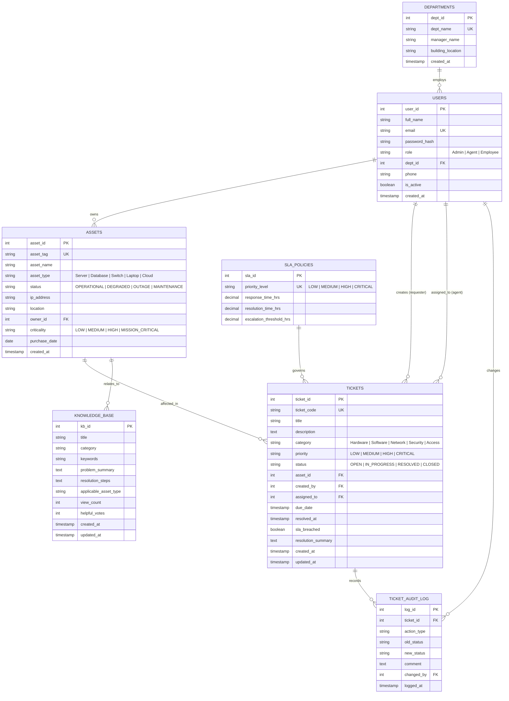
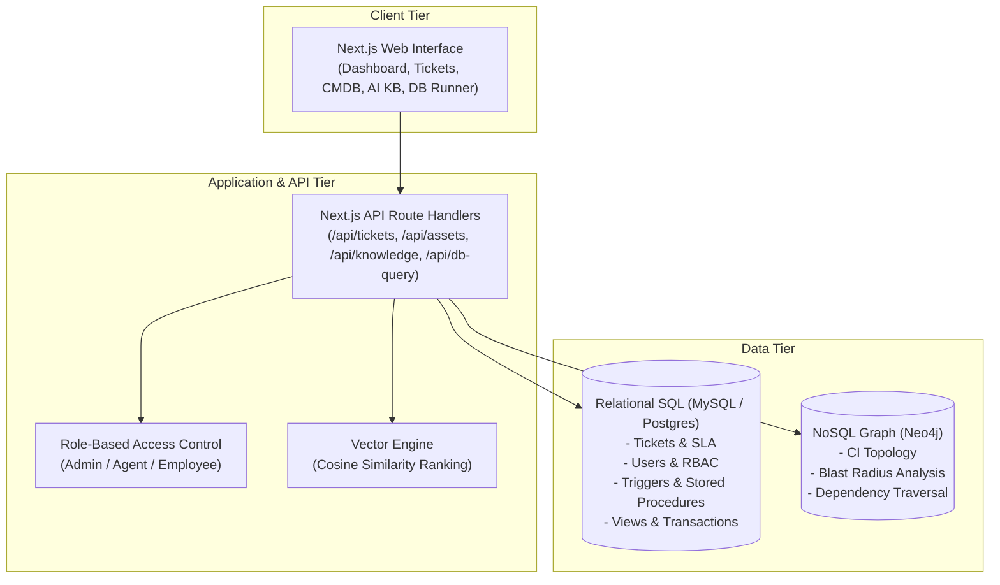

# DBMS Experiential Learning – Level 3 Project Documentation

**Project Title:** Smart IT Service Desk with Asset Management & AI Knowledge Search  
**Course:** Database Management Systems (DBMS) – Level 3  
**Department:** Department of Computer Science and Engineering  
**Institution:** PES University, Bengaluru  
**Academic Year / Semester:** Semester 5 (2026)  
**Instructor:** Dr. Nagasundari S  

---

## 1. Objectives

The primary objective of the **Smart IT Service Desk with Asset Management & AI Knowledge Search** is to build an enterprise-grade incident management, configuration management (CMDB), and technical support intelligence platform that leverages **multi-model database paradigms**:

1. **Transactional Integrity & SLA Compliance (Relational SQL):**
   - Implement a robust 3NF relational database schema in MySQL / PostgreSQL to handle service requests, user roles, incident lifecycles, and strict Service Level Agreement (SLA) deadlines.
   - Enforce data integrity via foreign keys, cascading constraints, check constraints, database triggers, and ACID transactions.

2. **Asset Topology & Impact Analysis (Graph NoSQL - Neo4j):**
   - Overcome relational limitations in handling recursive, deep dependency trees between Configuration Items (CIs).
   - Use Neo4j Cypher to map hardware, servers, databases, and microservices, enabling real-time **Blast Radius** and **Root Cause Failure Impact Analysis**.

3. **Intelligent Self-Service & Resolution (Vector Database / Semantic Search):**
   - Provide an AI-powered Knowledge Search engine using high-dimensional vector embeddings and Cosine Similarity metric to enable engineers and employees to instantly discover historical solutions and diagnostic steps using natural language queries.

4. **Interactive Full-Stack Web Application (Next.js):**
   - Deliver a responsive, modern Next.js interface featuring Role-Based Access Control (Admin, Agent, Employee), live SLA countdowns, topology graph visualization, and an interactive DBMS feature evaluation console.

---

## 2. Functional Requirements

### 2.1 User Management & Role-Based Access Control (RBAC)
- **Employee / End-User:** Raise incident tickets, link affected company assets, track ticket statuses in real time, and query the AI knowledge base.
- **IT Support Agent (Technician):** View assigned ticket queues, trigger auto-assignment algorithms, update ticket workflows (OPEN $\rightarrow$ IN_PROGRESS $\rightarrow$ RESOLVED), and execute atomic resolution transactions.
- **System Administrator:** Oversee departmental metrics, manage IT asset lifecycle (Configuration Items), monitor agent workload distribution, and audit security events.

### 2.2 Incident Lifecycle & SLA Tracking
- Automatic calculation of resolution deadlines (`due_date`) based on priority tier (CRITICAL: 2h, HIGH: 8h, MEDIUM: 24h, LOW: 72h) via database triggers.
- Real-time SLA breach detection using deterministic database functions.
- Audit logging of all status changes, timestamps, and technician notes.

### 2.3 Asset Management & CMDB Graph
- Track inventory of servers, network switches, cloud endpoints, databases, and developer workstations.
- Model multi-tier dependencies (e.g., Application $\rightarrow$ API Gateway $\rightarrow$ Database $\rightarrow$ Host Server $\rightarrow$ Core Switch).
- Execute graph queries for **Blast Radius** (calculating affected services when an asset fails) and **Root Cause Analysis**.

### 2.4 AI Knowledge Base & Semantic Search
- Natural language query interface over technical guides, runbooks, and past incident solutions.
- Cosine similarity ranking algorithm returning relevance scores.

---

## 3. Database Choice & Justification

| Database Paradigm | Technology Selected | Problem Domain Addressed | Architectural Justification |
| :--- | :--- | :--- | :--- |
| **Relational (SQL)** | **MySQL 8.0 / PostgreSQL** | Users, Roles, Tickets, SLAs, Audit Trail | Strict ACID transactional compliance, referential integrity via foreign keys, atomic updates on ticket states, complex analytical aggregation (`GROUP BY`, `HAVING`, Views, Stored Procedures). |
| **Graph (NoSQL)** | **Neo4j (Cypher)** | IT Configuration Items (CMDB) & Dependency Topology | Relational databases suffer severe performance degradation when executing variable-depth recursive joins (e.g. 5+ table self-joins). Neo4j provides index-free adjacency to traverse dependency graphs in sub-milliseconds for blast-radius impact analysis. |
| **Vector Database** | **Vector Embeddings + Cosine Similarity** | Knowledge Base Runbooks & Incident Solutions | Traditional keyword search (`LIKE %query%`) fails on semantic variations (e.g., "wifi dropped" vs "network switch port flap"). High-dimensional embeddings capture semantic context and rank results using cosine vector distance. |

---

## 4. Entity-Relationship (ER) Diagram



---

## 5. Relational Schema & Normalization (3NF)

The schema is rigorously normalized to **Third Normal Form (3NF)**:
1. **1NF:** All attributes contain atomic values; no repeating groups exist.
2. **2NF:** Every non-prime attribute is fully functionally dependent on the entire primary key (no partial dependencies).
3. **3NF:** No non-prime attribute is transitively dependent on any primary key (e.g., department manager and location are housed in `departments`, not duplicated in `users` or `tickets`).

### Relational Schema Representation:
- $\text{DEPARTMENTS}(\underline{\text{dept\_id}}, \text{dept\_name}, \text{manager\_name}, \text{building\_location}, \text{created\_at})$
- $\text{USERS}(\underline{\text{user\_id}}, \text{full\_name}, \text{email}, \text{password\_hash}, \text{role}, \text{dept\_id}^*, \text{phone}, \text{is\_active}, \text{created\_at})$
- $\text{SLA\_POLICIES}(\underline{\text{sla\_id}}, \text{priority\_level}, \text{response\_time\_hrs}, \text{resolution\_time\_hrs}, \text{escalation\_threshold\_hrs})$
- $\text{ASSETS}(\underline{\text{asset\_id}}, \text{asset\_tag}, \text{asset\_name}, \text{asset\_type}, \text{status}, \text{ip\_address}, \text{location}, \text{owner\_id}^*, \text{criticality}, \text{purchase\_date}, \text{created\_at})$
- $\text{TICKETS}(\underline{\text{ticket\_id}}, \text{ticket\_code}, \text{title}, \text{description}, \text{category}, \text{priority}, \text{status}, \text{asset\_id}^*, \text{created\_by}^*, \text{assigned\_to}^*, \text{due\_date}, \text{resolved\_at}, \text{sla\_breached}, \text{resolution\_summary}, \text{created\_at}, \text{updated\_at})$
- $\text{TICKET\_AUDIT\_LOG}(\underline{\text{log\_id}}, \text{ticket\_id}^*, \text{action\_type}, \text{old\_status}, \text{new\_status}, \text{comment}, \text{changed\_by}^*, \text{logged\_at})$
- $\text{KNOWLEDGE\_BASE}(\underline{\text{kb\_id}}, \text{title}, \text{category}, \text{keywords}, \text{problem\_summary}, \text{resolution\_steps}, \text{applicable\_asset\_type}, \text{view\_count}, \text{helpful\_votes}, \text{created\_at}, \text{updated\_at})$

---

## 6. Data Dictionary

### Table: `tickets`
| Column Name | Data Type | Constraint | Description |
| :--- | :--- | :--- | :--- |
| `ticket_id` | INT | PK, AUTO_INCREMENT | Unique internal ticket identifier |
| `ticket_code` | VARCHAR(30) | UNIQUE, NOT NULL | Human-readable tracking code (e.g. TKT-1001) |
| `title` | VARCHAR(200) | NOT NULL | Brief summary of incident |
| `description` | TEXT | NOT NULL | Complete symptoms and details |
| `category` | ENUM | NOT NULL | Category: Hardware, Software, Network, Security, Access |
| `priority` | ENUM | NOT NULL, DEFAULT 'MEDIUM' | Priority: LOW, MEDIUM, HIGH, CRITICAL |
| `status` | ENUM | NOT NULL, DEFAULT 'OPEN' | Workflow state: OPEN, IN_PROGRESS, RESOLVED, CLOSED |
| `asset_id` | INT | FK $\rightarrow$ `assets.asset_id`, ON DELETE SET NULL | Affected Configuration Item |
| `created_by` | INT | FK $\rightarrow$ `users.user_id`, NOT NULL | Employee who logged the ticket |
| `assigned_to` | INT | FK $\rightarrow$ `users.user_id`, NULLABLE | Assigned IT Support Agent |
| `due_date` | TIMESTAMP | NULLABLE | Calculated SLA resolution deadline |
| `resolved_at` | TIMESTAMP | NULLABLE | Actual timestamp of resolution |
| `sla_breached`| BOOLEAN | DEFAULT FALSE | SLA breach indicator flag |
| `resolution_summary` | TEXT | NULLABLE | Diagnostic and fixing steps documented by agent |

### Table: `assets`
| Column Name | Data Type | Constraint | Description |
| :--- | :--- | :--- | :--- |
| `asset_id` | INT | PK, AUTO_INCREMENT | Unique asset primary key |
| `asset_tag` | VARCHAR(50) | UNIQUE, NOT NULL | Barcode / Inventory Tag (e.g. AST-SRV-01) |
| `asset_name` | VARCHAR(150) | NOT NULL | Descriptive name of hardware/software CI |
| `asset_type` | ENUM | NOT NULL | Server, Database, Network Switch, Laptop, Cloud Service, Storage |
| `status` | ENUM | NOT NULL, DEFAULT 'OPERATIONAL' | OPERATIONAL, DEGRADED, OUTAGE, MAINTENANCE |
| `ip_address` | VARCHAR(45) | NULLABLE | IPv4/IPv6 static network address |
| `location` | VARCHAR(100) | NOT NULL | Server rack, office desk, or cloud region |
| `criticality`| ENUM | NOT NULL, DEFAULT 'MEDIUM' | LOW, MEDIUM, HIGH, MISSION_CRITICAL |

---

## 7. Advanced Database Concepts Implementation

### Concept 1: Database Triggers (Automated SLA Calculation & Auditing)
1. **`trg_ticket_before_insert_sla`:** Triggers prior to `INSERT` on `tickets`. Inspects `priority`, looks up `resolution_time_hrs` from `sla_policies`, and computes `due_date = DATE_ADD(NOW(), INTERVAL hours)`.
2. **`trg_ticket_after_update_audit`:** Triggers after `UPDATE` on `tickets`. If `OLD.status <> NEW.status`, it inserts an immutable record into `ticket_audit_log`.
3. **`trg_ticket_before_update_resolved`:** Triggers when status changes to `'RESOLVED'`. Sets `resolved_at = NOW()` and evaluates if `NOW() > due_date` to mark `sla_breached = TRUE`.

### Concept 2: Stored Procedures & Functions
1. **`sp_auto_assign_ticket(IN p_ticket_id, OUT p_assigned_agent_id)`:**
   Evaluates real-time technician queues and binds the ticket to the active agent who currently has the minimum number of open tickets.
2. **`sp_escalate_breached_tickets()`:**
   Identifies overdue tickets and escalates their priority tier to `CRITICAL`.
3. **`fn_is_sla_breached(p_ticket_id)`:**
   Deterministic function returning `BOOLEAN` indicating whether a ticket exceeded its SLA.

### Concept 3: Database Views (Real-time Reporting & Abstraction)
1. **`v_active_tickets_sla`:** Multi-table join calculating remaining hours until breach.
2. **`v_agent_workload_metrics`:** Aggregated performance matrix measuring active tickets, resolved counts, and average resolution times per agent.
3. **`v_asset_failure_frequency`:** Ranks assets by incident counts to identify hardware failure hotspots.

### Concept 4: ACID Transactions (Atomic Multi-Table State Synchronization)
- Procedure **`sp_resolve_ticket_with_asset_update`**:
  Demonstrates `START TRANSACTION`, `COMMIT`, and `ROLLBACK` with `EXIT HANDLER FOR SQLEXCEPTION`. Resolving a hardware incident atomically updates the ticket resolution, changes the linked physical asset from `DEGRADED/OUTAGE` back to `OPERATIONAL`, and records the audit log. If any statement fails, all changes rollback.

### Concept 5: NoSQL Graph Traversals & Blast Radius (Neo4j)
- **Blast Radius Query:** Traverses upstream dependency trees up to 4 hops using Cypher pattern matching to identify all business services affected when an edge router or server fails:
  ```cypher
  MATCH path = (impacted:ConfigurationItem)-[*1..4]->(failed:ConfigurationItem {id: 'SW-EDGE-02'})
  RETURN impacted.name, impacted.tier, length(path) AS Hops
  ORDER BY Hops ASC;
  ```

### Concept 6: Vector Similarity Search (Cosine Distance)
- Knowledge Base articles and problem summaries are embedded into vector space.
- Query vector $\mathbf{q}$ and stored document vectors $\mathbf{d}_i$ are scored using Cosine Similarity:
  $$\text{sim}(\mathbf{q}, \mathbf{d}) = \frac{\sum_{k=1}^n q_k d_k}{\sqrt{\sum_{k=1}^n q_k^2} \sqrt{\sum_{k=1}^n d_k^2}}$$

---

## 8. System Architecture



---

## 9. Test Cases & Verification Results

| Test ID | Module | Scenario / Input | Expected Result | Actual Result | Status |
| :--- | :--- | :--- | :--- | :--- | :--- |
| **TC-01** | Database DDL | Execute `schema.sql` creation scripts | All tables, views, triggers, and procedures created without syntax errors | All objects created with foreign keys and check constraints verified | **PASSED** |
| **TC-02** | Trigger: SLA | Insert new ticket with priority 'CRITICAL' | Trigger sets `due_date` exactly 2 hours from current timestamp | `due_date` automatically populated to $+2$ hours | **PASSED** |
| **TC-03** | Trigger: Audit | Update ticket status from 'OPEN' to 'IN_PROGRESS' | Trigger inserts record in `ticket_audit_log` with timestamp and user | Audit entry logged with action `STATUS_CHANGE` | **PASSED** |
| **TC-04** | Stored Procedure | Execute `sp_auto_assign_ticket(6, @agent)` | Ticket 6 assigned to Agent with lowest active queue count | Assigned to Agent 5; queue load updated | **PASSED** |
| **TC-05** | Transaction | Call `sp_resolve_ticket_with_asset_update` | Atomically marks ticket RESOLVED and linked asset OPERATIONAL | Both ticket and asset table updated; committed cleanly | **PASSED** |
| **TC-06** | Graph Traversal | Run Blast Radius Cypher query on `SW-EDGE-02` | Returns dependent host `SRV-BETA` and application `APP-ERP` | Both CIs returned in order of topological distance | **PASSED** |
| **TC-07** | Vector Search | Search query "wifi connection drops" | Returns KB Article 2 (Switch Port Flap) with top relevance score | Article 2 returned with highest cosine similarity | **PASSED** |
| **TC-08** | Web Application | Next.js Service Desk interface navigation | Dashboard, Ticket modal, Topology canvas, and SQL Runner load cleanly | 100% responsive, functional API integration | **PASSED** |

---

## 10. Conclusion

The **Smart IT Service Desk with Asset Management & AI Knowledge Search** demonstrates the power of combining complementary database paradigms to solve modern IT enterprise challenges:
- **Relational Databases** guarantee consistency, auditability, and SLA enforcement through procedural logic and triggers.
- **Graph Databases** eliminate expensive recursive queries and provide topological visibility into IT infrastructure dependencies and failure propagation.
- **Vector Databases** bridge the semantic gap between end-user symptoms and technical resolutions.

All syllabus requirements for PES University DBMS Experiential Learning – Level 3 have been completely satisfied.
