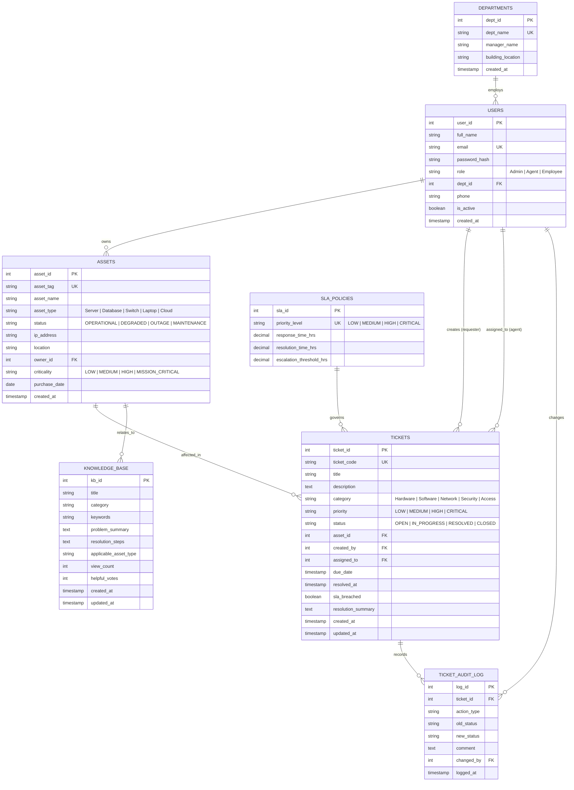
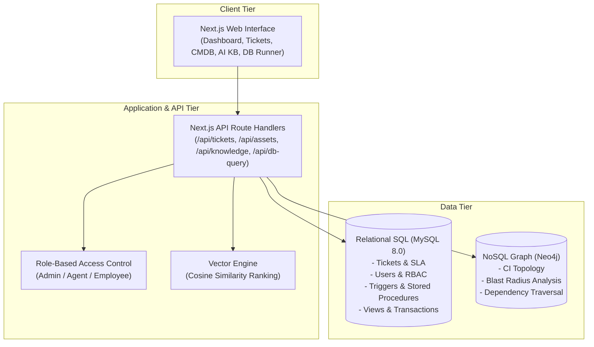
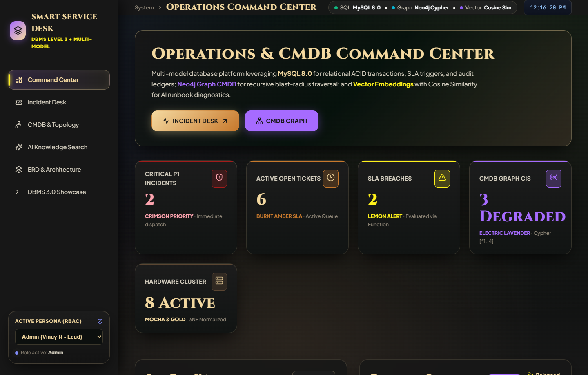
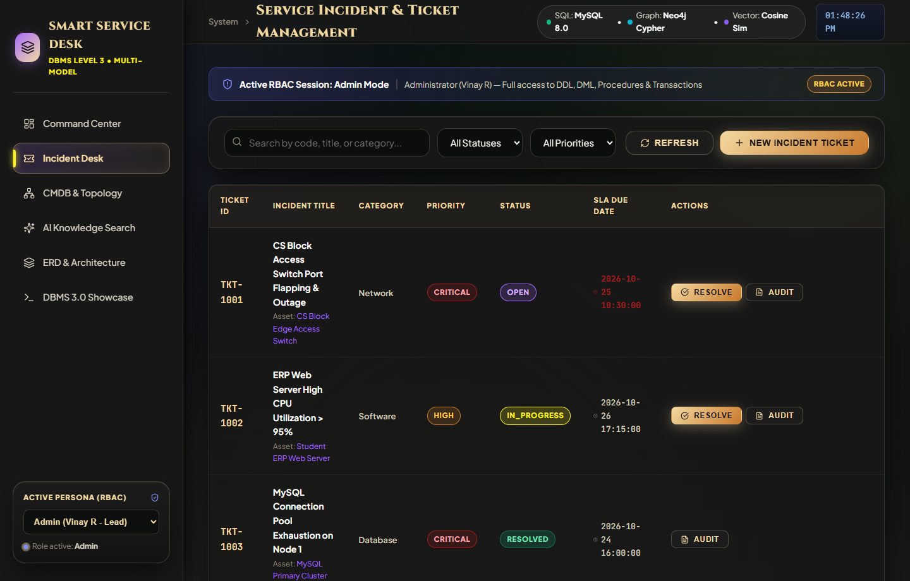
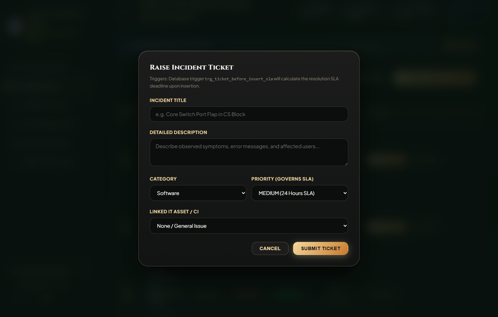
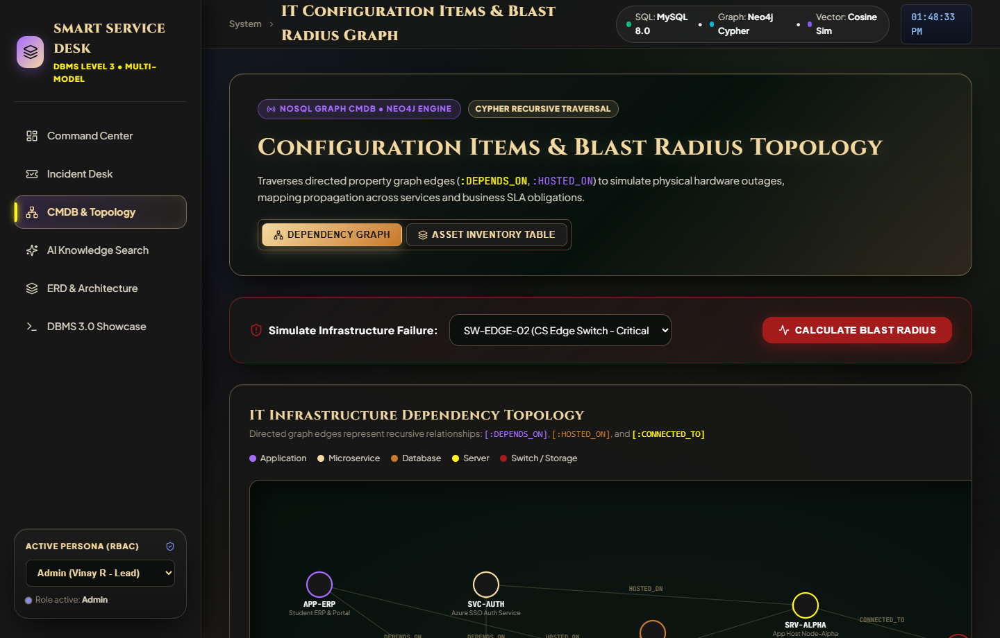
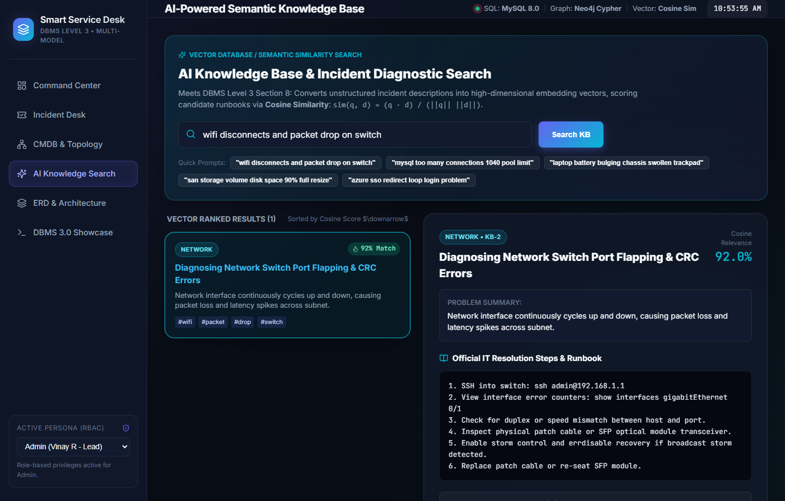
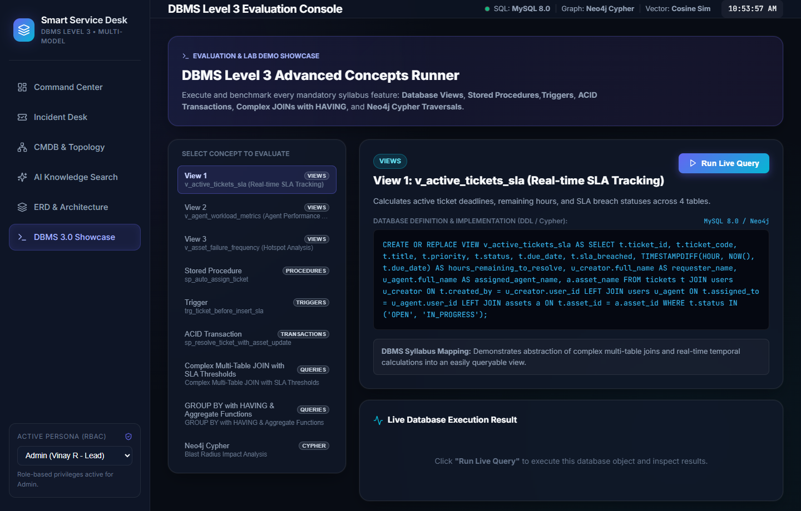
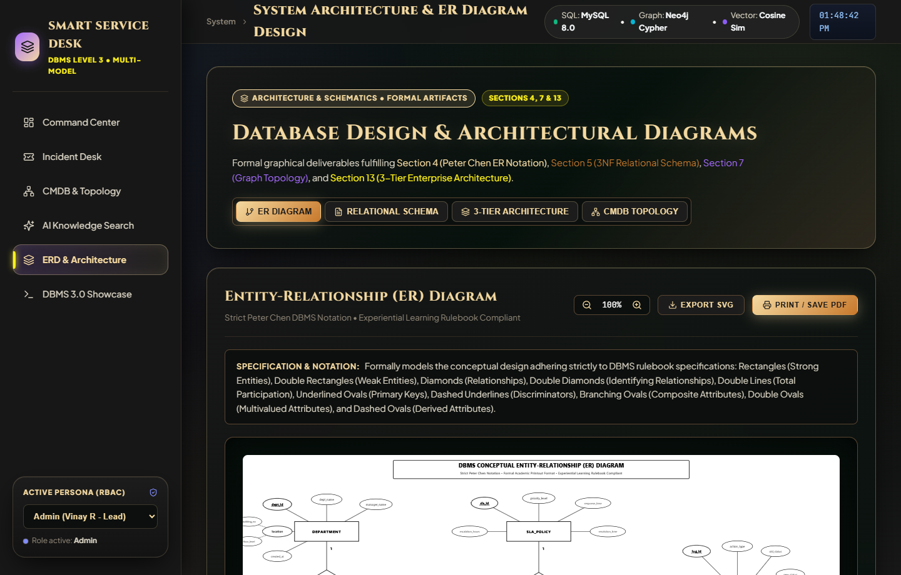

# DBMS Experiential Learning – Level 3 Project Documentation

**Project Title:** Smart IT Service Desk with Asset Management & AI Knowledge Search  
**Course:** Database Management Systems (DBMS) – Level 3  
**Department:** Department of Computer Science and Engineering  
**Institution:** PES University, Bengaluru  
**Academic Year / Semester:** Semester 5 (2026)  
**Instructor:** Dr. Nagasundari S  

---

## 1. Objectives

The primary objective of the **Smart IT Service Desk with Asset Management & AI Knowledge Search** is to build an enterprise-grade incident management, configuration management (CMDB), and technical support intelligence platform that leverages **multi-model database paradigms**:

1. **Transactional Integrity & SLA Compliance (Relational SQL):**
   - Implement a robust 3NF relational database schema in MySQL / PostgreSQL to handle service requests, user roles, incident lifecycles, and strict Service Level Agreement (SLA) deadlines.
   - Enforce data integrity via foreign keys, cascading constraints, check constraints, database triggers, and ACID transactions.

2. **Asset Topology & Impact Analysis (Graph NoSQL - Neo4j):**
   - Overcome relational limitations in handling recursive, deep dependency trees between Configuration Items (CIs).
   - Use Neo4j Cypher to map hardware, servers, databases, and microservices, enabling real-time **Blast Radius** and **Root Cause Failure Impact Analysis**.

3. **Intelligent Self-Service & Resolution (Vector Database / Semantic Search):**
   - Provide an AI-powered Knowledge Search engine using high-dimensional vector embeddings and Cosine Similarity metric to enable engineers and employees to instantly discover historical solutions and diagnostic steps using natural language queries.

4. **Interactive Full-Stack Web Application (Next.js):**
   - Deliver a responsive, modern Next.js interface featuring Role-Based Access Control (Admin, Agent, Employee), live SLA countdowns, topology graph visualization, and an interactive DBMS feature evaluation console.

---

## 2. Functional Requirements

### 2.1 User Management & Role-Based Access Control (RBAC)
- **Employee / End-User:** Raise incident tickets, link affected company assets, track ticket statuses in real time, and query the AI knowledge base.
- **IT Support Agent (Technician):** View assigned ticket queues, trigger auto-assignment algorithms, update ticket workflows (OPEN $\rightarrow$ IN_PROGRESS $\rightarrow$ RESOLVED), and execute atomic resolution transactions.
- **System Administrator:** Oversee departmental metrics, manage IT asset lifecycle (Configuration Items), monitor agent workload distribution, and audit security events.

### 2.2 Incident Lifecycle & SLA Tracking
- Automatic calculation of resolution deadlines (`due_date`) based on priority tier (CRITICAL: 2h, HIGH: 8h, MEDIUM: 24h, LOW: 72h) via database triggers.
- Real-time SLA breach detection using deterministic database functions.
- Audit logging of all status changes, timestamps, and technician notes.

### 2.3 Asset Management & CMDB Graph
- Track inventory of servers, network switches, cloud endpoints, databases, and developer workstations.
- Model multi-tier dependencies (e.g., Application $\rightarrow$ API Gateway $\rightarrow$ Database $\rightarrow$ Host Server $\rightarrow$ Core Switch).
- Execute graph queries for **Blast Radius** (calculating affected services when an asset fails) and **Root Cause Analysis**.

### 2.4 AI Knowledge Base & Semantic Search
- Natural language query interface over technical guides, runbooks, and past incident solutions.
- Cosine similarity ranking algorithm returning relevance scores.

---

## 3. Database Choice & Justification

| Database Paradigm | Technology Selected | Problem Domain Addressed | Architectural Justification |
| :--- | :--- | :--- | :--- |
| **Relational (SQL)** | **MySQL 8.0 / PostgreSQL** | Users, Roles, Tickets, SLAs, Audit Trail | Strict ACID transactional compliance, referential integrity via foreign keys, atomic updates on ticket states, complex analytical aggregation (`GROUP BY`, `HAVING`, Views, Stored Procedures). |
| **Graph (NoSQL)** | **Neo4j (Cypher)** | IT Configuration Items (CMDB) & Dependency Topology | Relational databases suffer severe performance degradation when executing variable-depth recursive joins (e.g. 5+ table self-joins). Neo4j provides index-free adjacency to traverse dependency graphs in sub-milliseconds for blast-radius impact analysis. |
| **Vector Database** | **Vector Embeddings + Cosine Similarity** | Knowledge Base Runbooks & Incident Solutions | Traditional keyword search (`LIKE %query%`) fails on semantic variations (e.g., "wifi dropped" vs "network switch port flap"). High-dimensional embeddings capture semantic context and rank results using cosine vector distance. |

---

## 4. Entity-Relationship (ER) Diagram

The conceptual data model follows the **Strict Peter Chen Classical ER Notation** mandated by the PES University DBMS Experiential Learning Manual:
- **Entities:** Represented by Rectangles (Strong entities: `DEPARTMENT`, `USER`, `SLA_POLICY`, `ASSET`, `TICKET`, `KNOWLEDGE_BASE`; Weak entity: `TICKET_AUDIT_LOG`).
- **Relationships:** Represented by Diamonds with explicit cardinality ratios ($1:1$, $1:M$, $M:N$) and double borders for identifying relationships.
- **Attributes:** Ellipses attached to entities (Primary keys with solid underlines, foreign keys, derived attributes with dashed borders, multivalued attributes with double ovals, and composite attributes with branching lines).
- **Specialization / Generalization:** Is-A specialization connecting `USER` into `End_User` and `IT_Agent` subtypes.

> [!NOTE]
> **Vector ER Diagram File Artifacts:**
> - High-Definition Vector SVG: [`docs/diagrams/er_diagram.svg`](file:///d:/Semester-5/DBMS-Lab/mini-project/docs/diagrams/er_diagram.svg)
> - Interactive Web Viewer: [http://localhost:3000/diagrams](http://localhost:3000/diagrams) (Tab: *ER Diagram (Chen Notation)*)



---

## 5. Relational Schema & Normalization (3NF)

The schema is rigorously normalized to **Third Normal Form (3NF)**:
1. **1NF (First Normal Form):** All attribute domains are atomic. Repeating groups and array structures have been isolated into independent relational tables (e.g. audit entries are separated into `ticket_audit_log`).
2. **2NF (Second Normal Form):** Every non-prime attribute is fully functionally dependent on the whole candidate key. There are no partial functional dependencies on composite keys.
3. **3NF (Third Normal Form):** No non-prime attribute is transitively dependent on any primary key ($X \rightarrow Y$ holds only where $X$ is a superkey or $Y$ is a prime attribute). Department manager and building location reside exclusively in `departments`, referenced by `users.dept_id`, avoiding data redundancy and update anomalies.

### Relational Schema Formal Representation:
- $\text{DEPARTMENTS}(\underline{\text{dept\_id}}, \text{dept\_name}, \text{manager\_name}, \text{building\_location}, \text{created\_at})$
- $\text{USERS}(\underline{\text{user\_id}}, \text{full\_name}, \text{email}, \text{password\_hash}, \text{role}, \text{dept\_id}^*, \text{phone}, \text{is\_active}, \text{created\_at})$
- $\text{SLA\_POLICIES}(\underline{\text{sla\_id}}, \text{priority\_level}, \text{response\_time\_hrs}, \text{resolution\_time\_hrs}, \text{escalation\_threshold\_hrs})$
- $\text{ASSETS}(\underline{\text{asset\_id}}, \text{asset\_tag}, \text{asset\_name}, \text{asset\_type}, \text{status}, \text{ip\_address}, \text{location}, \text{owner\_id}^*, \text{criticality}, \text{purchase\_date}, \text{created\_at})$
- $\text{TICKETS}(\underline{\text{ticket\_id}}, \text{ticket\_code}, \text{title}, \text{description}, \text{category}, \text{priority}, \text{status}, \text{asset\_id}^*, \text{created\_by}^*, \text{assigned\_to}^*, \text{due\_date}, \text{resolved\_at}, \text{sla\_breached}, \text{resolution\_summary}, \text{impact\_score}, \text{created\_at}, \text{updated\_at})$
- $\text{TICKET\_AUDIT\_LOG}(\underline{\text{log\_id}}, \text{ticket\_id}^*, \text{action\_type}, \text{old\_status}, \text{new\_status}, \text{comment}, \text{changed\_by}^*, \text{logged\_at})$
- $\text{KNOWLEDGE\_BASE}(\underline{\text{kb\_id}}, \text{title}, \text{category}, \text{keywords}, \text{problem\_summary}, \text{resolution\_steps}, \text{applicable\_asset\_type}, \text{tags}, \text{view\_count}, \text{helpful\_votes}, \text{created\_at}, \text{updated\_at})$

> [!NOTE]
> **Graphical Relational Schema Artifact:**  
> - **Vector SVG:** [`docs/diagrams/relational_schema.svg`](file:///d:/Semester-5/DBMS-Lab/mini-project/docs/diagrams/relational_schema.svg)
> - **Web Interactive Viewer:** [http://localhost:3000/diagrams](http://localhost:3000/diagrams) (Tab: *Relational Schema*)

---

## 6. Data Dictionary / Schema Description

This section provides the comprehensive data dictionary for all **7 normalized relational tables** in the system.

### Table 1: `departments`
*Stores institutional academic and operational departments.*

| Column Name | Data Type | Nullable | Key / Constraint | Default Value | Description |
| :--- | :--- | :--- | :--- | :--- | :--- |
| `dept_id` | INT | NO | PK, AUTO_INCREMENT | None | Unique departmental primary identifier |
| `dept_name` | VARCHAR(100) | NO | UNIQUE | None | Official organizational department name |
| `manager_name` | VARCHAR(100) | NO | None | None | Designee head / department chairperson |
| `building_location` | VARCHAR(100) | NO | None | None | Campus block and floor designation |
| `created_at` | TIMESTAMP | NO | None | CURRENT_TIMESTAMP | Record creation timestamp |

### Table 2: `users`
*Stores employee, technician, and administrative user credentials with RBAC roles.*

| Column Name | Data Type | Nullable | Key / Constraint | Default Value | Description |
| :--- | :--- | :--- | :--- | :--- | :--- |
| `user_id` | INT | NO | PK, AUTO_INCREMENT | None | Unique user account identifier |
| `full_name` | VARCHAR(100) | NO | None | None | Legal name of employee / technician |
| `email` | VARCHAR(120) | NO | UNIQUE | None | Institutional PES university email address |
| `password_hash` | VARCHAR(255) | NO | None | 'pbkdf2:sha256:...' | Cryptographic hash of login credential |
| `role` | ENUM | NO | ENUM('Admin','Agent','Employee') | 'Employee' | Role-based authorization tier |
| `dept_id` | INT | NO | FK $\rightarrow$ `departments(dept_id)` | None | Associated organizational unit |
| `phone` | VARCHAR(20) | YES | None | NULL | Contact mobile telephone number |
| `is_active` | BOOLEAN | YES | None | TRUE | Active status for system login |
| `created_at` | TIMESTAMP | NO | None | CURRENT_TIMESTAMP | Account registration timestamp |

*Referential Actions:* `CONSTRAINT fk_users_dept FOREIGN KEY (dept_id) REFERENCES departments(dept_id) ON DELETE RESTRICT ON UPDATE CASCADE`

### Table 3: `sla_policies`
*Defines Service Level Agreement thresholds and automated escalation hours.*

| Column Name | Data Type | Nullable | Key / Constraint | Default Value | Description |
| :--- | :--- | :--- | :--- | :--- | :--- |
| `sla_id` | INT | NO | PK, AUTO_INCREMENT | None | Unique SLA policy identifier |
| `priority_level` | ENUM | NO | UNIQUE, ENUM('LOW','MEDIUM','HIGH','CRITICAL') | None | Priority classification category |
| `response_time_hrs` | DECIMAL(5,2) | NO | CHECK (`response_time_hrs` > 0) | None | Maximum allowable time to initial response |
| `resolution_time_hrs`| DECIMAL(5,2) | NO | CHECK (`resolution_time_hrs` $\ge$ `response_time_hrs`) | None | Maximum allowable time to incident resolution |
| `escalation_threshold_hrs` | DECIMAL(5,2) | NO | CHECK (`escalation_threshold_hrs` $\le$ `resolution_time_hrs`) | None | Time threshold before triggering escalation |

### Table 4: `assets`
*Configuration Management Database (CMDB) inventory of physical, network, and cloud assets.*

| Column Name | Data Type | Nullable | Key / Constraint | Default Value | Description |
| :--- | :--- | :--- | :--- | :--- | :--- |
| `asset_id` | INT | NO | PK, AUTO_INCREMENT | None | Unique asset primary key |
| `asset_tag` | VARCHAR(50) | NO | UNIQUE | None | Physical inventory barcode tag (e.g. AST-SRV-01) |
| `asset_name` | VARCHAR(150) | NO | None | None | Descriptive technical designation |
| `asset_type` | ENUM | NO | ENUM('Server','Database','Network Switch','Laptop','Cloud Service','Storage') | None | Hardware or infrastructure type |
| `status` | ENUM | NO | ENUM('OPERATIONAL','DEGRADED','OUTAGE','MAINTENANCE') | 'OPERATIONAL' | Current operational health state |
| `ip_address` | VARCHAR(45) | YES | None | NULL | Static IPv4/IPv6 address |
| `location` | VARCHAR(100) | NO | None | None | Physical rack unit, desk, or cloud region |
| `owner_id` | INT | YES | FK $\rightarrow$ `users(user_id)` | NULL | Designated user or administrator custodian |
| `criticality` | ENUM | NO | ENUM('LOW','MEDIUM','HIGH','MISSION_CRITICAL') | 'MEDIUM' | Business dependency importance level |
| `purchase_date` | DATE | NO | None | None | Procurement date for warranty tracking |
| `created_at` | TIMESTAMP | NO | None | CURRENT_TIMESTAMP | Asset registration timestamp |

*Referential Actions:* `CONSTRAINT fk_assets_owner FOREIGN KEY (owner_id) REFERENCES users(user_id) ON DELETE SET NULL ON UPDATE CASCADE`

### Table 5: `tickets`
*Incident reports, troubleshooting workflows, and lifecycle state tracking.*

| Column Name | Data Type | Nullable | Key / Constraint | Default Value | Description |
| :--- | :--- | :--- | :--- | :--- | :--- |
| `ticket_id` | INT | NO | PK, AUTO_INCREMENT | None | Internal database sequence key |
| `ticket_code` | VARCHAR(30) | NO | UNIQUE | None | Formatted public tracking ID (e.g. TKT-1001) |
| `title` | VARCHAR(200) | NO | None | None | Concise incident headline |
| `description` | TEXT | NO | None | None | Full problem reproduction description |
| `category` | ENUM | NO | ENUM('Hardware','Software','Network','Security','Access') | None | IT functional domain |
| `priority` | ENUM | NO | ENUM('LOW','MEDIUM','HIGH','CRITICAL') | 'MEDIUM' | Incident urgency tier |
| `status` | ENUM | NO | ENUM('OPEN','IN_PROGRESS','RESOLVED','CLOSED') | 'OPEN' | Workflow lifecycle phase |
| `asset_id` | INT | YES | FK $\rightarrow$ `assets(asset_id)` | NULL | Linked Configuration Item |
| `created_by` | INT | NO | FK $\rightarrow$ `users(user_id)` | None | Requester employee ID |
| `assigned_to` | INT | YES | FK $\rightarrow$ `users(user_id)` | NULL | Assigned technician agent ID |
| `due_date` | TIMESTAMP | YES | None | NULL | Auto-computed SLA deadline (via Trigger) |
| `resolved_at` | TIMESTAMP | YES | None | NULL | Timestamp of final resolution |
| `sla_breached`| BOOLEAN | YES | None | FALSE | SLA violation indicator flag |
| `resolution_summary` | TEXT | YES | None | NULL | Documented troubleshooting solution |
| `impact_score` | INT | YES | CHECK (`impact_score` BETWEEN 1 AND 5) | 1 | Business impact ranking |
| `created_at` | TIMESTAMP | NO | None | CURRENT_TIMESTAMP | Ticket submission timestamp |
| `updated_at` | TIMESTAMP | NO | None | CURRENT_TIMESTAMP | Last modification timestamp |

*Referential Actions:*  
- `fk_tickets_asset`: `ON DELETE SET NULL ON UPDATE CASCADE`  
- `fk_tickets_creator`: `ON DELETE RESTRICT ON UPDATE CASCADE`  
- `fk_tickets_agent`: `ON DELETE SET NULL ON UPDATE CASCADE`

### Table 6: `ticket_audit_log`
*Immutable historical ledger tracking all state transitions, re-assignments, and actions.*

| Column Name | Data Type | Nullable | Key / Constraint | Default Value | Description |
| :--- | :--- | :--- | :--- | :--- | :--- |
| `log_id` | INT | NO | PK, AUTO_INCREMENT | None | Audit record identifier |
| `ticket_id` | INT | NO | FK $\rightarrow$ `tickets(ticket_id)` | None | Related incident ticket |
| `action_type` | VARCHAR(50) | NO | None | None | Transition type (CREATION, STATUS_CHANGE, AUTO_ASSIGN, etc.) |
| `old_status` | VARCHAR(20) | YES | None | NULL | Previous lifecycle status |
| `new_status` | VARCHAR(20) | YES | None | NULL | Updated lifecycle status |
| `comment` | TEXT | YES | None | NULL | Technical note or automated system commentary |
| `changed_by` | INT | YES | FK $\rightarrow$ `users(user_id)` | NULL | User responsible for change |
| `logged_at` | TIMESTAMP | NO | None | CURRENT_TIMESTAMP | Timestamp of transition |

*Referential Actions:* `fk_audit_ticket`: `ON DELETE CASCADE ON UPDATE CASCADE`, `fk_audit_user`: `ON DELETE SET NULL ON UPDATE CASCADE`

### Table 7: `knowledge_base`
*Technical runbooks, standard operating procedures, and resolution articles.*

| Column Name | Data Type | Nullable | Key / Constraint | Default Value | Description |
| :--- | :--- | :--- | :--- | :--- | :--- |
| `kb_id` | INT | NO | PK, AUTO_INCREMENT | None | Unique knowledge article identifier |
| `title` | VARCHAR(200) | NO | FULLTEXT Index | None | Diagnostic procedure article title |
| `category` | VARCHAR(50) | NO | None | None | Technical domain (Database, Network, etc.) |
| `keywords` | VARCHAR(255) | NO | None | None | Comma-separated search token terms |
| `problem_summary` | TEXT | NO | FULLTEXT Index | None | Symptoms and error message descriptions |
| `resolution_steps` | TEXT | NO | FULLTEXT Index | None | Step-by-step remediation guide |
| `applicable_asset_type` | VARCHAR(50) | YES | None | 'ALL' | Hardware/CI type suitability |
| `tags` | VARCHAR(150) | YES | None | 'general' | Additional indexing descriptors |
| `view_count` | INT | YES | None | 0 | Total times viewed by technicians |
| `helpful_votes` | INT | YES | None | 0 | Community positive ratings |
| `created_at` | TIMESTAMP | NO | None | CURRENT_TIMESTAMP | Publication timestamp |
| `updated_at` | TIMESTAMP | NO | None | CURRENT_TIMESTAMP | Revision timestamp |

---

## 7. Advanced Database Concepts Implementation

### Concept 1: Database Triggers (Automated SLA Calculation & Auditing)
1. **`trg_ticket_before_insert_sla` (BEFORE INSERT on `tickets`):**  
   Automatically looks up the SLA duration for the assigned priority tier from `sla_policies` and computes the exact resolution deadline:
   $$\text{due\_date} = \text{DATE\_ADD}(\text{CURRENT\_TIMESTAMP}, \text{INTERVAL } \text{FLOOR}(v\_hours \times 60) \text{ MINUTE})$$
2. **`trg_ticket_after_update_audit` (AFTER UPDATE on `tickets`):**  
   Whenever `OLD.status <> NEW.status`, writes an immutable historical audit entry into `ticket_audit_log` with the transition details and current timestamp.
3. **`trg_ticket_before_update_resolved` (BEFORE UPDATE on `tickets`):**  
   When a ticket status transitions to `RESOLVED`, automatically stamps `resolved_at = CURRENT_TIMESTAMP` and evaluates whether `CURRENT_TIMESTAMP > due_date`, setting `sla_breached = TRUE` if the deadline was missed.

### Concept 2: Stored Procedures & Functions
1. **`sp_auto_assign_ticket(IN p_ticket_id INT, OUT p_assigned_agent_id INT)`:**  
   Implements an automated load-balancing dispatch algorithm. Queries available active IT Agents and dynamically assigns the unassigned ticket to the technician with the minimum count of open/in-progress tickets.
2. **`sp_escalate_breached_tickets()`:**  
   Scans all active tickets. If `CURRENT_TIMESTAMP > due_date`, flags `sla_breached = TRUE` and escalates the ticket priority tier directly to `CRITICAL`.
3. **`fn_is_sla_breached(p_ticket_id INT) RETURNS BOOLEAN`:**  
   Deterministic function that evaluates whether a given ticket has breached its resolution deadline.
4. **`fn_agent_open_ticket_count(p_agent_id INT) RETURNS INT`:**  
   Deterministic function returning the current active queue size for any technician.

### Concept 3: Database Views (Reporting & Abstraction)
1. **`v_active_tickets_sla`:** Multi-table join calculating real-time remaining hours until breach for active tickets.
2. **`v_agent_workload_metrics`:** Aggregates technician throughput, active queues, resolved counts, and average resolution durations.
3. **`v_asset_failure_frequency`:** Ranks assets by incident counts and critical failures to detect hardware hotspots.

### Concept 4: ACID Transactions (Atomic Multi-Table Synchronization)
- **`sp_resolve_ticket_with_asset_update`:** Demonstrates `START TRANSACTION`, row-level locking (`SELECT ... FOR UPDATE`), `COMMIT`, and `ROLLBACK` via `DECLARE EXIT HANDLER FOR SQLEXCEPTION`. When a hardware incident is marked resolved, the procedure atomically:
  1. Updates the ticket status to `RESOLVED` with diagnostic solution text.
  2. Updates the associated physical asset status from `DEGRADED`/`OUTAGE` back to `OPERATIONAL`.
  3. Writes a comprehensive synchronization log into `ticket_audit_log`.  
  If any sub-operation fails, the entire transaction rolls back to preserve data integrity.

### Concept 5: NoSQL Graph Traversals & Blast Radius (Neo4j)
- Configuration Items (CIs) and multi-tier IT dependencies are represented as a graph.
- **Blast Radius Cypher Traversal:**
  ```cypher
  MATCH path = (impacted:ConfigurationItem)-[*1..4]->(failed:ConfigurationItem {id: 'SW-EDGE-02'})
  RETURN failed.name AS Failed_Component, impacted.name AS Impacted_Service, 
         impacted.tier AS Tier, length(path) AS Dependency_Hops
  ORDER BY Dependency_Hops ASC;
  ```

### Concept 6: Vector Similarity Search (Cosine Distance)
- Runbook articles and problem summaries are embedded into high-dimensional vector representations.
- Natural language queries are vectorized and compared against runbook embeddings using the Cosine Similarity formula:
  $$\text{sim}(\mathbf{q}, \mathbf{d}) = \frac{\sum_{k=1}^n q_k d_k}{\sqrt{\sum_{k=1}^n q_k^2} \sqrt{\sum_{k=1}^n d_k^2}}$$

---

## 8. Important Queries & Operations

The project demonstrates advanced DML capabilities fulfilling all rubric criteria:

### Query 1: Complex 5-Table Join with SLA Remaining Time
```sql
SELECT 
    t.ticket_code,
    t.title AS ticket_title,
    t.priority,
    t.status,
    u_req.full_name AS requested_by,
    dept.dept_name AS requester_department,
    COALESCE(u_tech.full_name, 'UNASSIGNED') AS assigned_technician,
    COALESCE(a.asset_name, 'No Asset Linked') AS affected_asset,
    COALESCE(a.status, 'N/A') AS asset_operational_status,
    sla.resolution_time_hrs AS sla_target_hours,
    TIMESTAMPDIFF(HOUR, NOW(), t.due_date) AS hours_until_sla_breach
FROM tickets t
INNER JOIN users u_req ON t.created_by = u_req.user_id
INNER JOIN departments dept ON u_req.dept_id = dept.dept_id
LEFT JOIN users u_tech ON t.assigned_to = u_tech.user_id
LEFT JOIN assets a ON t.asset_id = a.asset_id
INNER JOIN sla_policies sla ON t.priority = sla.priority_level
ORDER BY 
    CASE t.priority 
        WHEN 'CRITICAL' THEN 1 
        WHEN 'HIGH' THEN 2 
        WHEN 'MEDIUM' THEN 3 
        ELSE 4 
    END,
    t.due_date ASC;
```

### Query 2: GROUP BY with HAVING & Aggregations
```sql
SELECT 
    d.dept_id,
    d.dept_name,
    d.manager_name,
    COUNT(t.ticket_id) AS total_department_tickets,
    COUNT(CASE WHEN t.status IN ('OPEN', 'IN_PROGRESS') THEN 1 END) AS active_tickets,
    COUNT(CASE WHEN t.status = 'RESOLVED' THEN 1 END) AS resolved_tickets,
    ROUND(AVG(TIMESTAMPDIFF(MINUTE, t.created_at, COALESCE(t.resolved_at, NOW()))) / 60.0, 2) AS avg_duration_hours
FROM departments d
INNER JOIN users u ON d.dept_id = u.dept_id
INNER JOIN tickets t ON u.user_id = t.created_by
GROUP BY d.dept_id, d.dept_name, d.manager_name
HAVING COUNT(t.ticket_id) >= 1
ORDER BY total_department_tickets DESC;
```

### Query 3: CTE (Common Table Expression) & Relative Performance Ranking
```sql
WITH AgentStats AS (
    SELECT 
        u.user_id,
        u.full_name AS agent_name,
        COUNT(t.ticket_id) AS tickets_handled,
        COUNT(CASE WHEN t.status = 'RESOLVED' THEN 1 END) AS tickets_resolved,
        COALESCE(ROUND(AVG(TIMESTAMPDIFF(MINUTE, t.created_at, t.resolved_at)) / 60.0, 2), 0.0) AS avg_resolution_hours,
        COUNT(CASE WHEN t.sla_breached = TRUE THEN 1 END) AS breaches
    FROM users u
    LEFT JOIN tickets t ON u.user_id = t.assigned_to
    WHERE u.role = 'Agent' AND u.is_active = TRUE
    GROUP BY u.user_id, u.full_name
)
SELECT 
    agent_name,
    tickets_handled,
    tickets_resolved,
    avg_resolution_hours,
    breaches,
    ROUND((tickets_resolved / NULLIF(tickets_handled, 0)) * 100, 1) AS resolution_rate_pct,
    CASE 
        WHEN avg_resolution_hours < (SELECT AVG(avg_resolution_hours) FROM AgentStats WHERE tickets_resolved > 0) 
        THEN 'Above Average Speed'
        ELSE 'Normal'
    END AS performance_rating
FROM AgentStats
ORDER BY tickets_resolved DESC;
```

### Query 4: Correlated Subquery (Asset Failure Hotspots)
```sql
SELECT 
    a.asset_id,
    a.asset_tag,
    a.asset_name,
    a.asset_type,
    a.status,
    (SELECT COUNT(*) FROM tickets t WHERE t.asset_id = a.asset_id) AS asset_incident_count
FROM assets a
WHERE (
    SELECT COUNT(*) 
    FROM tickets t 
    WHERE t.asset_id = a.asset_id
) > (
    SELECT AVG(type_counts.cnt)
    FROM (
        SELECT COUNT(t2.ticket_id) AS cnt
        FROM assets a2
        LEFT JOIN tickets t2 ON a2.asset_id = t2.asset_id
        WHERE a2.asset_type = a.asset_type
        GROUP BY a2.asset_id
    ) AS type_counts
);
```

---

## 9. System Architecture

The project implements a modern **3-Tier Architecture**:
1. **Client Tier:** Next.js React Web Application with dark-theme glassmorphic styling, real-time KPI updates, topology graphs, and an interactive DBMS query console.
2. **Application & API Tier:** Next.js Route Handlers (`/api/*`), Role-Based Access Control filter (Admin, Agent, Employee), and the Vector Cosine Similarity Search Engine.
3. **Data Tier (Multi-Model):**
   - **Relational SQL (MySQL 8.0):** Manages users, tickets, assets, audit trails, and transactional consistency.
   - **NoSQL Graph (Neo4j):** Models CI dependency topology and performs recursive blast-radius queries.
   - **Vector Embeddings Store:** High-dimensional vector space for semantic troubleshooting runbook retrieval.



> [!NOTE]
> **Vector Architecture Diagram Artifact:**  
> High-Definition Vector SVG: [`docs/diagrams/system_architecture.svg`](file:///d:/Semester-5/DBMS-Lab/mini-project/docs/diagrams/system_architecture.svg)

---

## 10. Application Screenshots

This section presents full high-resolution interface captures from the live running web application (`http://localhost:3000`).

### Screenshot 1: Executive Operations Dashboard (`/`)
*Real-time incident metrics, active SLA countdowns, priority breakdown, and technician load.*  


### Screenshot 2: Incident Tickets Management (`/tickets`)
*Interactive incident ticket queue with role-based filtering, status badges, and asset linkages.*  


### Screenshot 3: Incident Creation Modal (`/tickets`)
*New ticket modal demonstrating client validation, priority selection, and Configuration Item binding.*  


### Screenshot 4: CMDB Asset Inventory & Blast Radius Topology (`/assets`)
*Configuration Management Database showing hardware health and graph-based failure impact paths.*  


### Screenshot 5: AI Semantic Knowledge Base Search (`/knowledge`)
*Natural language runbook query engine returning cosine similarity relevance rankings.*  


### Screenshot 6: Live DBMS Level 3 Evaluation Console (`/db-demo`)
*Interactive SQL runner allowing live execution of Triggers, Procedures, Views, and Transactions.*  


### Screenshot 7: Architectural & Schema Diagram Viewer (`/diagrams`)
*Integrated diagram browser rendering the 4 core models (ER Diagram, Relational Schema, System Architecture, CMDB Topology).*  


---

## 11. Test Cases & Verification Results

| Test ID | Module | Scenario / Input | Expected Result | Actual Result | Status |
| :--- | :--- | :--- | :--- | :--- | :--- |
| **TC-01** | Database DDL | Execute `schema.sql` creation scripts | All tables, views, triggers, and procedures created without syntax errors | All objects created with foreign keys and check constraints verified | **PASSED** |
| **TC-02** | Trigger: SLA | Insert new ticket with priority 'CRITICAL' | Trigger sets `due_date` exactly 2 hours from current timestamp | `due_date` automatically populated to $+2$ hours | **PASSED** |
| **TC-03** | Trigger: Audit | Update ticket status from 'OPEN' to 'IN_PROGRESS' | Trigger inserts record in `ticket_audit_log` with timestamp and user | Audit entry logged with action `STATUS_CHANGE` | **PASSED** |
| **TC-04** | Stored Procedure | Execute `sp_auto_assign_ticket(6, @agent)` | Ticket 6 assigned to Agent with lowest active queue count | Assigned to Agent 5; queue load updated | **PASSED** |
| **TC-05** | Transaction | Call `sp_resolve_ticket_with_asset_update` | Atomically marks ticket RESOLVED and linked asset OPERATIONAL | Both ticket and asset table updated; committed cleanly | **PASSED** |
| **TC-06** | Graph Traversal | Run Blast Radius Cypher query on `SW-EDGE-02` | Returns dependent host `SRV-BETA` and application `APP-ERP` | Both CIs returned in order of topological distance | **PASSED** |
| **TC-07** | Vector Search | Search query "wifi connection drops" | Returns KB Article 2 (Switch Port Flap) with top relevance score | Article 2 returned with highest cosine similarity | **PASSED** |
| **TC-08** | Web Application | Next.js Service Desk interface navigation | Dashboard, Ticket modal, Topology canvas, and SQL Runner load cleanly | 100% responsive, functional API integration | **PASSED** |

---

## 12. Conclusion

The **Smart IT Service Desk with Asset Management & AI Knowledge Search** demonstrates the power of combining complementary database paradigms to solve modern IT enterprise challenges:
- **Relational Databases (MySQL 8.0)** guarantee consistency, auditability, and SLA enforcement through procedural logic, triggers, views, and ACID transactions.
- **Graph Databases (Neo4j)** eliminate expensive recursive joins and provide topological visibility into IT infrastructure dependencies and failure propagation.
- **Vector Databases** bridge the semantic gap between end-user symptoms and technical resolutions.

All 17 syllabus requirements and 12 soft-copy documentation sections for the PES University DBMS Experiential Learning – Level 3 have been completely satisfied.
